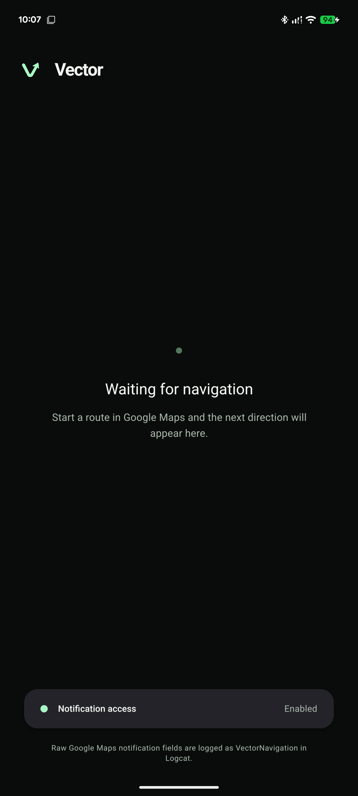
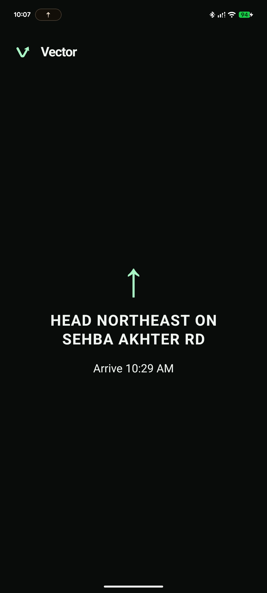

<div align="center">
  

  <h1>Vector</h1>

  <p><strong>Turn-by-turn navigation, distilled.</strong></p>
  <p>
    A focused Android navigation display built with Expo, React Native,<br />
    React Native Paper, and a native Kotlin notification listener.
  </p>

  <p>
    
    
    
    
  </p>
</div>

---

Vector reads active Google Maps navigation notifications on Android and turns
them into a minimal, glanceable navigation screen. The next maneuver, distance,
road, and ETA stay visually dominant so the display is useful without becoming
distracting.

> [!NOTE]
> Navigation notification reading is currently Android-only. The iOS app remains
> functional and explains the platform limitation.

## Preview

<div align="center">
  <table>
    <tr>
      <td align="center"><strong>Ready for a route</strong></td>
      <td align="center"><strong>Navigation in progress</strong></td>
    </tr>
    <tr>
      <td align="center">
        
      </td>
      <td align="center">
        
      </td>
    </tr>
  </table>
</div>

## What it does

- Detects active Google Maps navigation through Android's
  `NotificationListenerService`.
- Extracts the maneuver, maneuver distance, road, ETA, and navigation state.
- Sends native navigation updates from Kotlin to React Native.
- Handles left, right, slight turns, straight, U-turns, roundabouts, and arrival.
- Falls back gracefully when Google Maps omits or changes notification fields.
- Logs raw Google Maps notification fields in development builds for parser
  refinement.

## How it works

```text
Google Maps notification
          ↓
Android NotificationListenerService
          ↓
Kotlin parser and state store
          ↓
Expo native module event
          ↓
React Native navigation display
```

## Getting started

### Requirements

- Node.js 20+
- pnpm
- Android Studio and an Android SDK
- An Android device or emulator

### Install and run

```bash
pnpm install
pnpm android
```

Vector uses a custom native Android module, so it requires a development build
and cannot run inside Expo Go.

When the app opens, select **Open settings** and enable Notification Access for
Vector. Then start a route in Google Maps. Vector will automatically switch from
the waiting screen to the active navigation display.

## Development

Start Metro for an installed development build:

```bash
pnpm start
```

Run the project checks:

```bash
pnpm lint
pnpm typecheck
cd android && ./gradlew :vector-navigation:testDebugUnitTest
```

Inspect raw navigation notifications while testing:

```bash
adb logcat -v time VectorNavigation:D ReactNativeJS:D AndroidRuntime:E '*:S'
```

## Project structure

```text
src/app/                         Expo Router screens
src/components/                  Navigation display UI
src/hooks/                       React Native navigation state
modules/vector-navigation/       Kotlin listener, parser, and Expo module
screenshots/                     App previews used in this README
```

## Scope

This repository currently implements Vector Phase 1: reading and presenting
Google Maps navigation notifications. It contains no Bluetooth, BLE, ESP32, or
device-connection code.

<div align="center">
  <br />
  
  <p><sub>Built for the road ahead.</sub></p>
</div>
